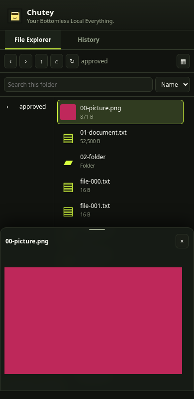
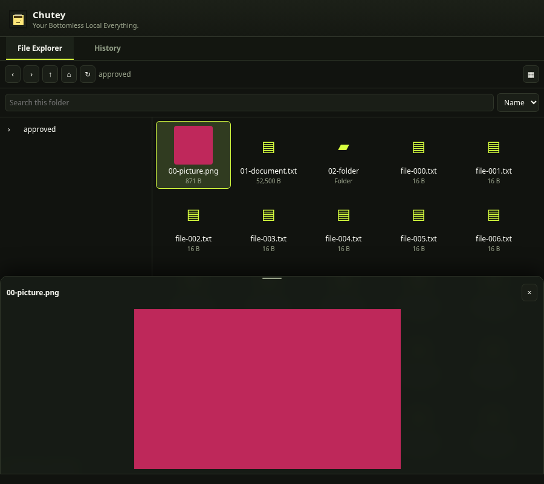

The File Explorer tab was a placeholder. This adds an API-first **read-only review checkpoint** using the existing Python companion, plus a thin Shelf navigator, lazy thumbnails, scoped context menu, true bottom-overlay previews, deterministic production-API laboratory, and an optional REDOWN handoff schema.

**This does not complete the requested Windows drag-and-drop MVP.** The implementation contract explicitly requires unproven arbitrary-directory writes to stay disabled. Windows native handles/reparse protection and enrolled native folder consent are not verified; therefore roots on Windows, filesystem mutations, OS Open/Reveal, local/browser and REDOWN transfers remain blocked. No synthetic event or URL shortcut is reported as a successful transfer. The known-working release/tag/binaries and existing drag/native/History paths are unchanged.

## Architecture and source audit

Shelf `explorer-api.js` → existing `ChuteServer` → authenticated `ExplorerAPI` → `Explorer.execute` ← deterministic Python lab. `RootGrant` uses descriptor-relative no-follow POSIX access. No second daemon, worker, native host, provider adapter or History database. Exact owner-approved Origin, short-lived bearer, exact loopback Host, opaque handles, request/decoder limits and concurrency bounds guard the opt-in read namespace. It defaults disabled.

| Sources | Finding / evidence |
| --- | --- |
| Existing MV3/native wake/reconnect | Unchanged; cold-boot/native fixture regressions pass. Installed Windows startup/resume still unverified |
| Existing Store/History/Recall/reveal | Authoritative and preserved; complete Python regression passes |
| `content.js`, `drag-relay.js`, `bin.js` | History-ID token → actual File → file-input/synthetic drop; not a general local capability protocol. URL fetch failures can become shortcuts in the old basket; that fallback is not reused here |
| Site-specific Google/Yandex and lifecycle code | Preserved. No real Google/ChatGPT/Yandex cross-window upload acceptance claimed; synthetic events do not prove trusted upload |
| REDOWN Explorer/menu/lab references | Inspected at `8665e8b`; dispatcher, lazy trees, independent oracle and uncertainty patterns only; no cloud auth/provider code copied |

Full audit, usage, architecture, limitations and reproduction: [docs/explorer/README.md](README.md). Versioned, disabled interop interface: [docs/explorer/INTEROP.md](INTEROP.md).

## Walkthrough and proof

On POSIX, explicitly start the existing companion with `--explorer-root` and the installed Chutey's exact `--explorer-origin`, then paste its short-lived local read token in the Shelf. Browse expandable folders; search/sort; switch list/grid; select an image or text file; use the scoped Preview/Properties menu. Preview overlays the lower viewport and leaves underlying layout/scroll intact. The read session is never persisted or placed in a URL. This manual flow is not native enrollment and does not enable the installed Windows EXE.

Screenshots are real Chromium renderings of generated disposable fixture files. Browser geometry evidence uses production assets/API with explicit **test transport and Chrome storage stubs**, not installed-extension or live-site drag proof.

## Validation

- Full Python suite: **58 passed, 34 subtests passed**; one unrelated anyio pytest deprecation warning.
- Seed 731 lab: **9 PASS, 8 BLOCKED, 0 FAIL**, 40 bounded navigation transitions, independent SHA-256 inventories and empty before/after diff. Blocked operations are not passes. Reports: `docs/explorer/evidence/`.
- Chromium at 390px list and 900px five-column grid: exact unchanged list width/height/columns on preview, true overlap, independent document scroll, actual image decoding, scoped menu keys and History/tab scroll retention pass.
- Existing JS syntax, worker boot, thumbnails/icons, tabs/mascot/card/gutter and package checks pass; Chrome ZIP builds. Existing builder has a pre-existing `.with_suffix()` naming defect producing `chute-chrome-2.6.zip`; manifest remains 2.6.1.
- New API CI covers Linux/Windows; only POSIX descriptor cases run on Linux, with explicit Windows skips. Existing Windows EXE and Chrome test-build workflows are enabled for this branch. **CI results are pending, not claimed passed.**

## Remaining acceptance gates

- Windows native consent/identity and handle/reparse guards; write transactions, hash verification/conflicts, durable operation journal/reconciliation, cancellation and restart cases.
- Full mutation menu/keyboard/drag behavior, nested copy/move target menus, reopened-Shelf path/expanded-state persistence.
- Large native video streaming and verified sandboxed PDF playback/rendering; current media GUI uses bounded Blobs.
- Installed extension and Windows companion pairing; real native recovery and Google/ChatGPT/Yandex drags.
- Joint REDOWN R2↔local byte/hash acceptance, then Drive/Dropbox/OneDrive separately; no provider credentials accessed.
- Existing `verify-real-image-browser.py` CLI runner timed out with both the launcher and direct Chromium binary; the final Playwright test separately proves actual saved History PNG rendering. The timeout is not classified as a pass.
- Installed-extension Chromium mode is blocked in this instance: system browser did not load unpacked extension; official Playwright download is denied by network policy.

Review as a draft/read-only foundation. Do not merge, release or replace the known-good pairing until the outstanding product/security gates are completed.
